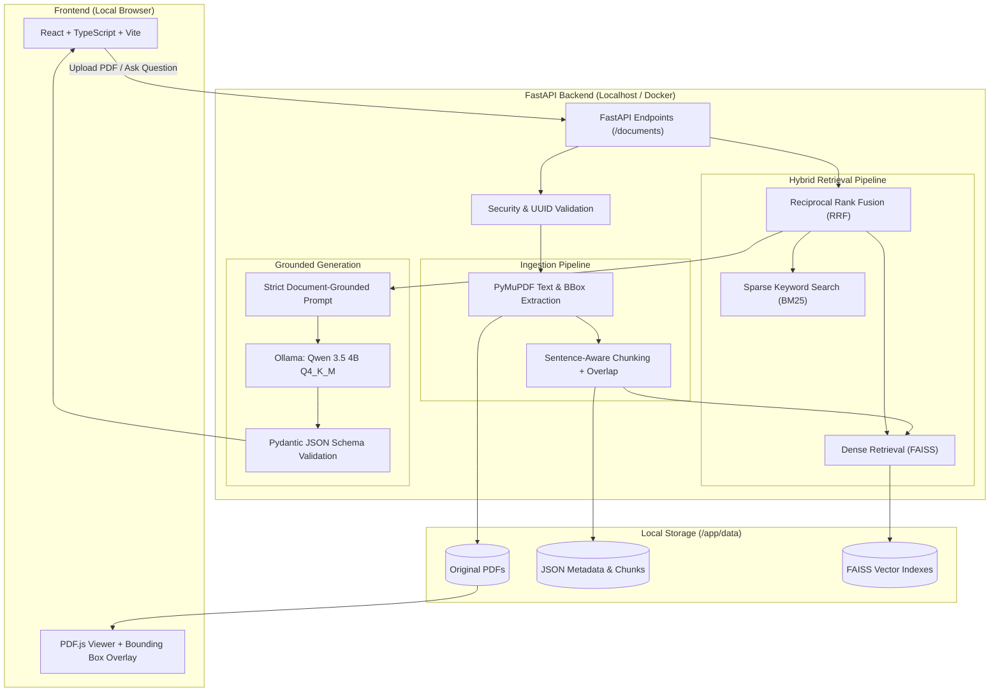

# CivicLens

> Privacy-first, local document intelligence assistant for official documents, applications, and guidelines.

CivicLens helps citizens, students, and applicants understand complex official documents with high fidelity. It extracts and analyzes requirements locally without leaking sensitive documents to external cloud APIs or third-party LLM providers.

---

## The Problem CivicLens Solves

Many official documents (scholarships, government permits, visa instructions, university applications) use nuanced qualifiers and conditional requirements:
- *"A strong application is made up of some or all of the following: essays, references, transcripts, CV/resume, and interviews."*

Standard RAG systems often produce semantic errors such as converting *"some or all"* into a mandatory checklist (*"Applicants MUST submit essays, references, and interviews"*). CivicLens enforces strict requirement preservation, qualifier discipline, and evidence grounding:
- **Mandatory vs. Optional**: Distinguishes `must`/`required` from `may`/`can`/`some or all`.
- **Conditional Rules**: Preserves conditions (`if`, `unless`, `where applicable`).
- **Citation Integrity**: Resolves chunk IDs back to exact pages, text, and bounding boxes for in-browser visual PDF inspection.
- **Explicit Insufficient Evidence**: Distinguishes between completely missing evidence and passages that discuss a topic without establishing mandatory obligations.

---

## Architecture

CivicLens runs entirely on your local machine across five integrated layers:



---

## Technology Stack

- **Frontend**: React 19, TypeScript, Vite, `react-pdf` / `pdfjs-dist`, Lucide Icons
- **Backend**: FastAPI, Python 3.12, Uvicorn, Pydantic v2, HTTPX
- **PDF Extraction**: PyMuPDF (`fitz`)
- **Embeddings**: `sentence-transformers/all-MiniLM-L6-v2` (running locally via CPU/PyTorch)
- **Vector Index**: FAISS (`faiss-cpu`)
- **Keyword Search**: Rank-BM25 (Okapi BM25)
- **Local Inference**: Ollama (`qwen3.5:4b-q4_K_M`)
- **Containerization**: Docker Compose

---

## Prerequisites

- **OS**: Windows 10/11, macOS, or Linux
- **Python**: 3.12+
- **Node.js**: v20+ (tested on v25.8 / npm 11+)
- **Docker Desktop** (optional, for containerized backend)
- **Ollama**: Installed and running locally ([ollama.ai](https://ollama.ai))
- **RAM**: 16 GB recommended for local 4B model inference

---

## Installation & Quickstart (Windows PowerShell)

### 1. Clone & Set Up Ollama

```powershell
# Pull the recommended model in Ollama
ollama run qwen3.5:4b-q4_K_M

# Verify Ollama is running at http://localhost:11434
Invoke-RestMethod http://localhost:11434/api/tags
```

### 2. Backend Setup

#### Option A: Running with Docker Compose (Recommended)
```powershell
docker compose up --build -d
```
The backend API is now running at `http://localhost:8000`.

#### Option B: Running Locally with Python Virtual Environment
```powershell
cd backend
python -m venv .venv
.\.venv\Scripts\Activate.ps1
pip install -r requirements.txt
uvicorn app.main:app --host 0.0.0.0 --port 8000 --reload
```

### 3. Frontend Setup

```powershell
cd frontend
npm install
npm run dev
```
Open your browser at `http://localhost:5173`.

---

## API Endpoints

| Method | Endpoint | Description |
|---|---|---|
| `GET` | `/health` | Check API health |
| `GET` | `/health/ollama` | Verify local Ollama connection and loaded models |
| `GET` | `/documents` | List all processed documents |
| `POST` | `/documents/upload` | Upload a PDF (validates magic bytes, max size, readability) |
| `POST` | `/documents/{id}/index` | Extract chunks and build local FAISS index |
| `GET` | `/documents/{id}/file` | Stream the original PDF for browser viewing |
| `GET` | `/documents/{id}/search?q=...` | Perform hybrid FAISS + BM25 search |
| `POST` | `/documents/{id}/ask` | Generate an evidence-grounded answer with citations |
| `DELETE`| `/documents/{id}` | Permanently delete PDF, metadata, and FAISS index files |

---

## Automated Test Suite

CivicLens includes 35 comprehensive automated tests covering answer accuracy, sentence preservation, citation integrity, and security:

```powershell
cd backend
.\.venv\Scripts\pytest -v
```

### Test Coverage Highlights
- **12 Adversarial Quality Tests**:
  - Optional list preservation ("some or all" ≠ mandatory)
  - Mandatory requirement identification
  - Conditional rule preservation ("if education not in English")
  - Recommendation vs requirement ("encouraged to" ≠ compulsory)
  - Insufficient evidence handling when requirements are unmentioned
  - Quantifier preservation ("up to three" ≠ exactly three)
  - Explicit exceptions ("except students whose transcripts...")
  - Double negations ("not considered complete without...")
  - Interview possibility ("may include an interview")
  - Conflicting passage detection and dual citation
  - Citation ID validation and unknown ID rejection
  - Empty retrieval fallback
- **Presentation State Tests**:
  - No evidence found
  - Relevant passage retrieved without establishing requirement
  - Supported answer
- **Sentence-Aware Chunking Tests**:
  - Boundary condition integrity
  - Overlap preservation
  - Multi-page continuous paragraphs
  - Bounding box deduplication
- **Security & Error Handling Tests**:
  - Oversized file rejection (HTTP 413)
  - Magic byte verification (rejection of non-PDFs renamed as `.pdf`)
  - Corrupted PDF handling
  - Path traversal and non-UUID ID protection
  - Clean deletion of all artifacts

---

## Privacy Architecture

1. **Zero Cloud Dependencies**: CivicLens does not call OpenAI, Anthropic, Google Cloud, or any external API. All embeddings and LLM calls run on `localhost`.
2. **Local Storage**: All files are stored under `/app/data` (`data/documents`, `data/indexes`, `data/metadata`).
3. **No External Analytics**: The frontend imports zero third-party CDNs, tracking scripts, or external font stylesheets.
4. **Complete Data Removal**: Calling `DELETE /documents/{id}` completely unlinks the raw PDF, chunk metadata, and FAISS vector index from disk.

---

## Known Limitations

- **Complex Unpunctuated Tables**: PDF tables lacking standard punctuation marks (`.`, `!`, `?`) fall back to line-based boundaries.
- **Ultra-Long Sentences**: An individual sentence exceeding `max_chars` (1200 characters) forms its own chunk rather than splitting mid-word.
- **Citation ID Validation vs. Semantic Entailment**: The verification layer strictly verifies that citation IDs originate from retrieved chunks and rejects invalid/hallucinated IDs. It does not mathematically verify full semantic entailment of every generated phrase.
- **Local Small Model Variance**: Qwen 3.5 4B provides fast local inference on consumer hardware; however, nuanced linguistic edge cases may occasionally require rephrasing the question.
